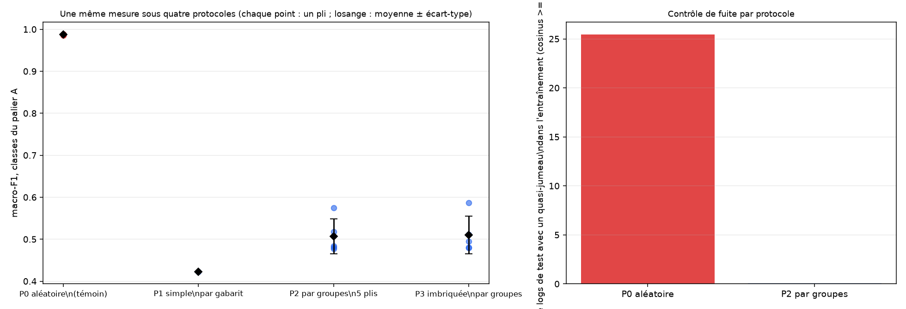
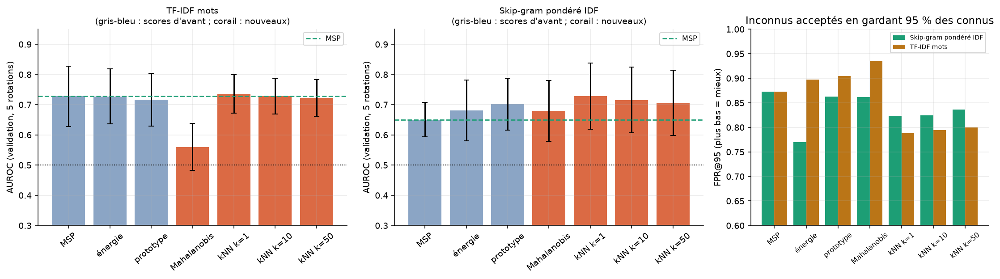
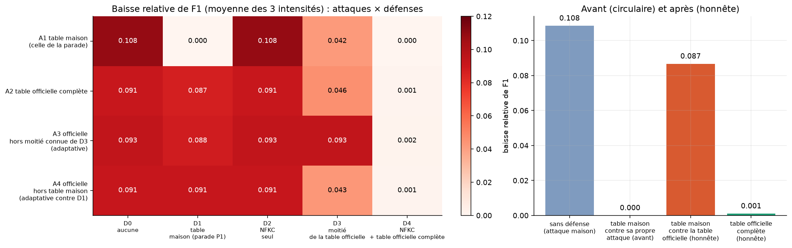

# Classification hiérarchique de logs SIEM en monde ouvert (SIEVE)

> **English summary.** Can a classifier label security-log events in a two-level taxonomy *and* recognise events that belong to none of the learned classes (open-set / out-of-distribution detection)? Using the SIEVE synthetic SIEM dataset, this project shows that scores reported with random splits (≈ 0.97 macro-F1) collapse to ≈ 0.46 once evaluation is **grouped by log template**, that unknown-class detection is weak (AUROC ≈ 0.60), that a Transformer encoder does not change the picture on its own (but Mahalanobis on its vectors beats the softmax score), and that a homoglyph "defence" only works if it knows the attacker's character table. Everything is in one executable notebook with pre-registered decision rules, a sealed and journaled test set, and a verified bibliography.

Projet du cours de traitement automatique du langage naturel (ESP / UCAD), projet 2 de la proposition *SIEVE pipelines* : **peut-on classer un événement de sécurité dans une taxonomie à deux niveaux tout en reconnaissant qu'il n'appartient à aucune classe apprise ?**

Auteur : Madeniyou Sall ([@MADENIYOU](https://github.com/MADENIYOU)).

## Résultats principaux

| Question | Résultat |
|---|---|
| Que valent les scores publiés sur SIEVE ? | **≈ 0,97** de macro-F1 avec un découpage aléatoire, mais **≈ 0,46** (30 classes, test scellé) quand on sépare **par gabarit** : le jeu est fabriqué à partir de 440 gabarits, un modèle y reconnaît des gabarits connus plus qu'il ne comprend les événements. |
| Détecte-t-on les classes inconnues ? | **Faiblement** : AUROC **0,60** au test (0,73 en validation ; 0,50 = hasard), **92 %** des inconnus passent encore en gardant 95 % des connus. Aucun des scores essayés (MSP, énergie, prototype, ensemble, kNN, Mahalanobis, OpenMax) ne bat le MSP de façon régulière sur les modèles linéaires. |
| L'encodeur Transformer aide-t-il ? | Pas seul : au test il est au niveau ou sous TF-IDF (macro-F1 0,46 contre 0,49 ; AUROC du MSP 0,55 sur 3 graines contre 0,60). **Mahalanobis sur ses vecteurs** dépasse le MSP dans les 5 rotations (AUROC **0,605**, +0,057) et rattrape TF-IDF sans le dépasser. |
| La hiérarchie (famille → classe) aide-t-elle ? | Non démontrée : le signe de l'écart change entre validation et test, toujours dans les marges d'erreur. Le repli sur la famille n'est pas démontré utile. |
| Robustesse aux modifications des logs ? | Les **homoglyphes** (lettres d'autres alphabets) sont l'attaque la plus efficace (−21,5 % de macro-F1 pour TF-IDF mots à 30 %). Une normalisation avec la **table officielle Unicode UTS #39** ramène la perte à ≈ 0,001 ; la table « maison » de l'attaque ne protégeait que parce qu'elle la connaissait (**défense circulaire**). |
| Les fichiers du professeur (35 000 logs) testent-ils la généralisation ? | Non : mêmes gabarits, valeurs nouvelles. Un modèle qui a vu tous les gabarits y obtient **0,97**, un modèle dont le gabarit vient du jeu de test **0,44** : une seconde mise en évidence de la fuite. |







## Ce qui rend le travail fiable

- **Test scellé et journalisé** : le jeu de test s'ouvre une seule fois, avec une trace datée ; les choix sont figés avant l'ouverture.
- **Règles de décision écrites avant les chiffres** (seuils, critères de succès S1 à S8, hypothèses H1 à H15 avec ce qui les réfuterait).
- **Découpage par gabarit** (gabarits reconstruits : 311 retrouvés sur 440), validation croisée par groupes et validation imbriquée, intervalles de confiance par gabarit.
- **Réglages sans jamais regarder les classes masquées** (classes connues masquées « pour de faux »).
- **Bibliographie vérifiée** (73 références, niveau de vérification indiqué) et **registre de 99 affirmations** chiffrées avec leur source.
- Les échecs et les hypothèses réfutées sont conservés et expliqués (H1, H13 réfutées ; défaut de circularité corrigé en 9.12).

## Contenu du dépôt

| Chemin | Contenu |
|---|---|
| `TP2_logs_hierarchique_monde_ouvert.ipynb` | **Le notebook** (zone de vérité) : étapes 0 à 10, état de l'art, analyses, figures, registre des affirmations, fiche de questions. |
| `src/` | Modules : prétraitement (`tp2_logtext`), vecteurs de mots (`tp2_vec`), modèle ouvert (`tp2_openset`), attaques (`tp2_attacks`), encodeur (`tp2_encoder`), figures (`tp2_sota_figs`, `tp2_new_figs`). |
| `scripts/` | Lanceur du notebook (`run_notebook.py`) et correctifs appliqués au notebook. |
| `colab/` | Notebooks Colab de l'encodeur, scripts de calcul local (Mac, GPU Apple), taxonomie et rotations. |
| `artifacts/results/` | Tous les résultats chiffrés (CSV, JSON), dont `success_criteria.json`. |
| `artifacts/figures/` | Les 43 figures du notebook. |
| `artifacts/data/` | Découpages par gabarit (`splits_v1.csv.gz`), gabarits reconstruits, table de confusables (sans texte de logs). |
| `presentation/` | Présentation de soutenance (`Soutenance_SIEM_monde_ouvert.pptx`, 17 diapositives dont les références) et son script de construction (`build_deck.js`, `build.sh`). |
| `etat_de_l_art/` | Sources vérifiées et table Unicode UTS #39 (`confusables.txt`, v18.0.0, somme de contrôle dans le notebook). |

## Données

Le jeu **SIEVE** (Artioli, Dentamaro, Galantucci, Magrì, Pellegrini, Semeraro, *Computer Networks* 266, 111330, 2025) n'est **pas redistribué** ici : il est fourni sur demande par les auteurs (`sieve.requests@bvtech.com`). Placer les six fichiers `SIEVE_00_100K.csv` à `SIEVE_05_100K.csv` dans `artifacts/data/raw/sieve_extracted/`. Les six niveaux de perturbation correspondent à p = 0 ; 0,1 ; … ; 0,5, avec 30 classes équilibrées.

Les fichiers de 35 000 logs fournis par le professeur (`output_*.log`) ne sont pas non plus inclus ; la section 5.9 du notebook les attend dans le dossier parent du projet. Les 440 logs réels du CDS (transfert E5) ne faisaient pas partie de l'archive reçue : cette expérience n'a pas pu être faite.

## Reproduire

```bash
python3.12 -m venv .venv && source .venv/bin/activate
pip install -r requirements.txt
# depuis le dossier du projet, avec les données en place :
python scripts/run_notebook.py      # exécute tout le notebook (≈ 15 min avec les caches, plusieurs heures sans)
```

- **Ne pas définir `MPLBACKEND=Agg`** (les figures en ligne disparaîtraient).
- Les calculs longs sont **reprenables** : chaque modèle, rotation et graine est mis en cache.
- **Encodeur** : DistilBERT sans casse, 256 jetons, 2 époques, entraîné sur Google Colab (GPU T4) et sur un Mac (puce M3 Pro, GPU Apple, attention classique car l'attention rapide ne gère pas le Monte-Carlo dropout). Les poids (266 Mo chacun) ne sont pas dans le dépôt ; `colab/local/run_local_v3.py` les recalcule (graines 42, 43, 44 × 5 rotations, environ 17 min chacun).

## Limites assumées

- La **taxonomie** à 8 familles (adossée à ECS) est une **hypothèse de démonstration**, non validée par un expert SIEM.
- Les **gabarits sont reconstruits**, pas fournis ; 12 classes sur 30 ont moins de 5 gabarits.
- **Puissance statistique limitée** (36 gabarits de validation, 45 de test pour le palier A) : un écart inférieur à environ 0,05 est indétectable.
- **Trois graines** pour l'encodeur, une pour la plupart des autres modèles ; scores ajoutés après l'ouverture du test évalués sur la validation seulement.
- Les attaques sont en grande partie **non adaptatives** ; E5 (transfert vers des logs réels) n'a pas pu être faite.

## Références

Voir la bibliographie vérifiée dans le notebook (section 0.1b) et `etat_de_l_art/sources_verifiees.md`. Pour l'avertissement de la norme sur les caractères confondables : Unicode Technical Standard #39 (*Unicode Security Mechanisms*).

## Licence

Code : MIT (voir `LICENSE`). Les données SIEVE restent soumises aux conditions de leurs auteurs.
